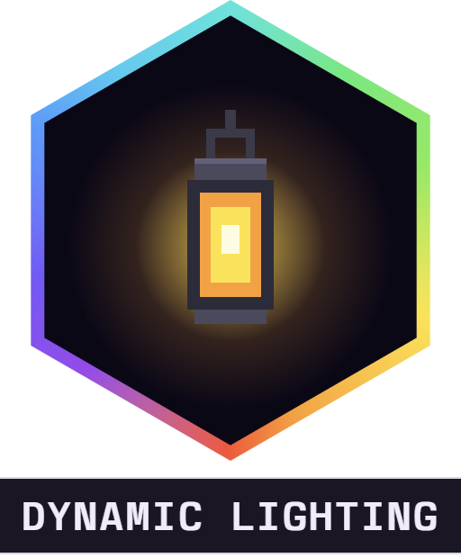

<div align="center">



# Dynamic Lighting

[](https://github.com/alaydriem/amml-dynamic-lighting/releases)
[](https://github.com/alaydriem/amml-dynamic-lighting/actions/workflows/build.yml)
[](./LICENSE)

[](https://github.com/alaydriem/amml)

</div>

Hold a torch or a lantern and the world around you lights up. The light moves with you as you walk.

Client-side and visual only. The mod changes how the terrain is drawn, not the light levels of the world, so mobs still spawn where they would without it.

## Usage

- Hold a light-giving item in your main hand or your offhand. The terrain around you is drawn lit at that item's light level. If both hands hold a light, the brighter one counts.
- The level is the one the item's block gives when you place it: a torch gives 14, a lantern 15, a soul torch 10, a redstone torch 7. New light blocks, and light blocks from add-ons, work too.
- A lava bucket (15) and a blaze rod (10) also give light, although they place no block.
- Switch to an item that gives no light and the light goes out.
- Press <kbd>F3</kbd> + <kbd>D</kbd> to turn the light on or off. The key can be changed on the mod manager's Keybinds page.

It works in the normal renderer and in Vibrant Visuals.

### Vibrant Visuals

In Vibrant Visuals the mod turns off the game's own light calculation in the part of the world your light reaches. While you stand near a placed torch, that torch is drawn with normal-renderer light instead of Vibrant Visuals light. It changes back when you walk away. The light can also move in small steps instead of fully smoothly.

## Installation

Install it with the [AMML launcher](https://github.com/alaydriem/amml/releases/latest). The launcher also installs the AMML loader and Alaydriem's Mod Manager, which this mod needs.

## Configuration

Settings are in the mod manager panel (<kbd>Ctrl</kbd> + <kbd>Shift</kbd> + <kbd>F10</kbd>) and saved to `mods/amml/@amml/dynamic-lighting/config/config.hcl`. Changes apply at once.

| Setting | Default | Description |
| --- | --- | --- |
| `lighting.enabled` | `true` | Held light-giving items light up the terrain around you |
| `lighting.round` | `true` | On: the light fades by straight-line distance, as a round pool of light. Off: it fades by block steps, like a placed torch |
| `lighting.level_override` | `0` | `0` uses the light level of the held item. `1` to `15`: every light-giving item lights at this level. Items that give no light never light |
| `keys.toggle` | `"F3+D"` | Turns the light on or off |

## Performance

The mod adds no measurable time to the frame. It adds about 40 nanoseconds to each light lookup when the game builds terrain, on the game's worker threads. While you walk with a light, the game rebuilds the terrain near you about 20 times a second, in the background.

## Building

Requires Windows x64, [mise](https://mise.jdx.dev), rustup and [cargo-nextest](https://nexte.st).

```powershell
mise trust
mise run preflight
mise run package
mise run test
```

## License

BSD 3-Clause. Copyright (c) 2026 Charles R. Portwood II. See [LICENSE](./LICENSE).
